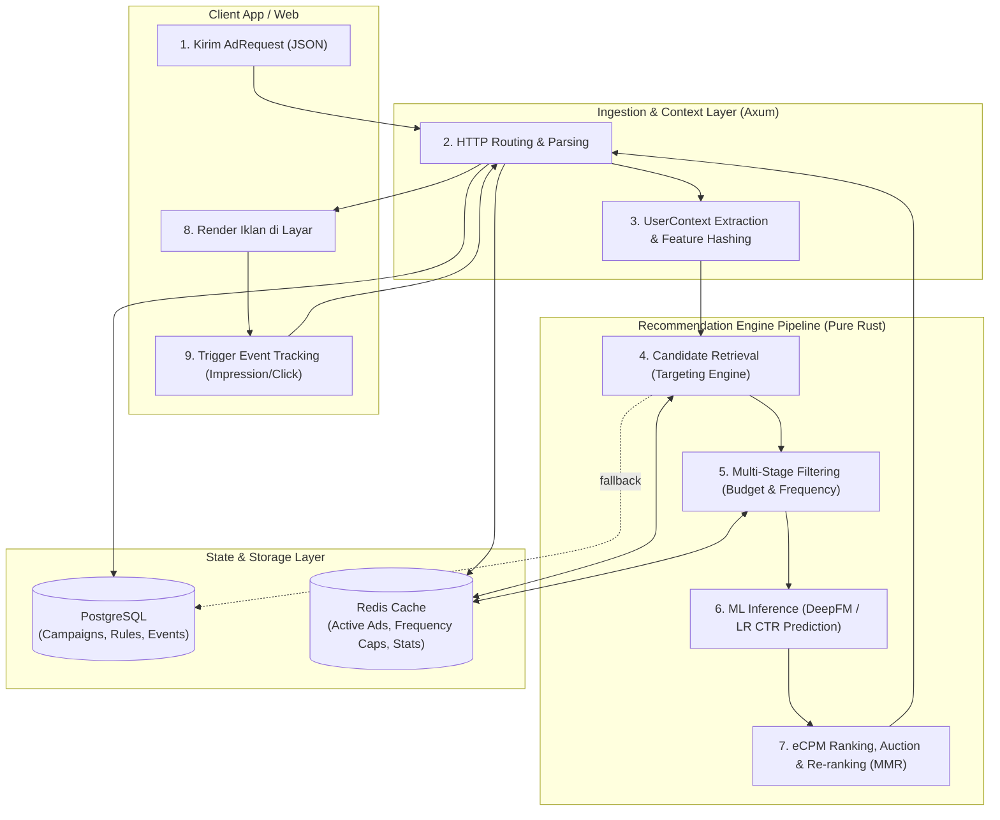
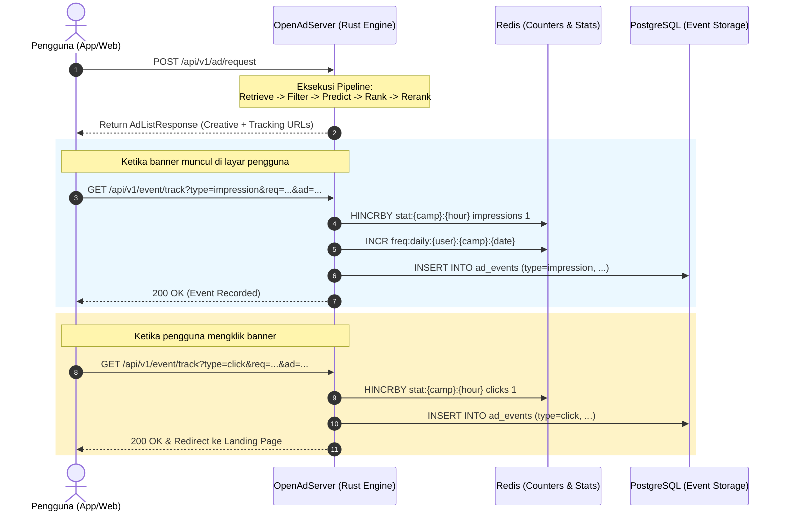

# OpenAdServer: Arsitektur & Pipeline End-to-End

Dokumentasi ini menjelaskan secara menyeluruh tentang tujuan bisnis dan teknis dari **OpenAdServer**, serta bagaimana pipeline pemrosesan iklannya berjalan secara *end-to-end* mulai dari kedatangan request hingga siklus umpan balik (*event tracking feedback loop*).

---

## 1. Tujuan dan Motivasi Sistem (Purpose)

### 1.1. Latar Belakang Masalah
Dalam industri periklanan digital (*ad-tech*), sistem penayangan iklan konvensional menghadapi tantangan besar:
1. **Waterfall / Static Serving Tidak Efisien**: Penayangan iklan berbasis daftar statis atau rotasi acak menghasilkan *Click-Through Rate* (CTR) yang rendah dan menyia-nyiakan impresi bernilai tinggi.
2. **Ketergantungan pada Pihak Ketiga (Walled Gardens)**: Solusi seperti Google Ad Manager memungut bagi hasil (*revenue share*) sebesar 20–30% dan mengunci data pengguna/pengiklan.
3. **Latensi Tinggi**: Penambahan model Machine Learning pada platform berbasis Python/PHP kerap kali menaikkan latensi penayangan hingga puluhan atau ratusan milidetik, yang berdampak buruk pada *bounce rate* aplikasi dan pengalaman pengguna.

### 1.2. Tujuan Utama OpenAdServer
OpenAdServer dibangun sebagai platform *computational advertising* mandiri (*self-hosted*), transparan, dan berkinerja tinggi dalam bahasa **Rust** dengan 4 pilar tujuan:

* **Yield Maximization (Memaksimalkan Pendapatan Publisher)**:
  Menggunakan formula lelang terpadu berbasis **eCPM (effective Cost Per Mille)** untuk membandingkan penawaran dari berbagai model bisnis (CPM, CPC, CPA) secara adil pada setiap lelang milidetik.
* **Relevance & User Engagement (Relevansi bagi Pengguna)**:
  Mengintegrasikan model Machine Learning *in-process* (**DeepFM** & **Logistic Regression**) untuk memprediksi probabilitas klik pengguna ($pCTR$) dan konversi ($pCVR$) secara personal dan kontekstual.
* **Advertiser ROI & Pacing (Kepatuhan Kontrak Advertiser)**:
  Menjamin target audiens tepat sasaran (*targeting rules*), menjaga pengeluaran anggaran harian agar merata dan tidak habis seketika (*budget pacing*), serta mencegah kejenuhan iklan (*frequency capping*).
* **Ultra-Low Latency (< 10 ms SLA)**:
  Seluruh alur keputusan lelang (retrieval, filtering, inferensi ML ratusan fitur, kalkulasi eCPM, diversifikasi, dan lelang) dieksekusi secara asinkron dalam **< 1.5 milidetik**.

---

## 2. Diagram Alur Pipeline End-to-End

Berikut adalah alur perjalanan sebuah request iklan dari client hingga pencatatan event impresi/klik:

---

## 3. Rincian 7 Tahap Pipeline End-to-End

### Tahap 1: Ingestion & Context Enrichment (Penerimaan Request)
Client (aplikasi Android, iOS, atau situs web) mengirimkan HTTP POST ke `/api/v1/ad/request`.
* **Payload Request**:
  * `slot_id`: Identitas posisi slot penempatan iklan (misal: `banner_home_top`, `interstitial_endgame`).
  * `user_id`: Identitas unik pengguna atau IDFA/GAID.
  * `device`: Data perangkat (OS, versi OS, brand, model, resolusi layar, bahasa).
  * `geo`: Lokasi pengguna (IP address, negara, kota, koordinat).
  * `context`: Informasi aplikasi induk (App ID, nama aplikasi, tipe jaringan seperti WiFi/5G).
  * `user_features`: Fitur segmentasi pengguna (usia, gender, daftar minat/minat belanja).
* **Pemrosesan Context**:
  * Sistem mengabstraksikan request menjadi struktur `UserContext`.
  * IP klien otomatis dideteksi dari header (`x-forwarded-for` / `x-real-ip`).
  * Hash ID pengguna (`hash_user_id`) dibuat menggunakan algoritma Murmur3/FNV-1a cepat untuk penentuan partisi cache dan bucket A/B testing.

---

### Tahap 2: Candidate Retrieval & Targeting (Pencarian Kandidat Relevan)
Dari ribuan materi kampanye yang tersimpan, sistem menyaring kandidat awal yang memenuhi kriteria penargetan (*hard constraints*).
* **Mekanisme Targeting Rule**:
  Setiap kampanye memiliki aturan berbasis tipe data JSON:
  * **Geo Targeting**: Mencocokkan negara/kota (misal: hanya user di `"ID"` atau `"SG"`).
  * **OS & Device Targeting**: Mencocokkan sistem operasi (misal: hanya `"android"` dengan versi $\ge 12$).
  * **Demografi**: Rentang usia (`min_age`, `max_age`) dan jenis kelamin (`male`/`female`).
  * **Interest & App Category**: Mencocokkan minat pengguna (misal: `"technology"`, `"gaming"`).
  * **Mode Rule**: Mendukung aturan penyertaan (`is_include: true`) maupun pengecualian (*blacklist*, `is_include: false`).
* **Optimasi Cache Multilevel**:
  * Kampanye aktif dan aturannya disimpan dalam memori Redis (`ads:active`) dengan format serialized JSON.
  * Apabila Redis belum terisi atau terjadi *cache miss*, sistem mengambil data dari PostgreSQL dan memperbarui cache secara asinkron.
  * Hasil tahap ini adalah kumpulan `Vec<AdCandidate>`.

---

### Tahap 3: Multi-Stage Filtering (Penyaringan Anggaran & Frekuensi)
Sebelum kandidat masuk ke model Machine Learning (yang membutuhkan komputasi matriks), sistem melakukan eliminasi cepat:
1. **Budget Filter (Pacing Kontrol)**:
   * Mengambil data akumulasi belanja harian kampanye dari Redis (`budget:{campaign_id}:{date}`).
   * Jika $\text{spent\_today} \ge \text{budget\_daily} \times \text{buffer\_ratio}$, kampanye langsung didiskualifikasi agar pengiklan tidak mengalami *overspending*.
2. **Frequency Capping Filter (Anti-Fatigue)**:
   * Mencegah pengguna melihat iklan yang sama terlalu sering, yang dapat menurunkan efektivitas iklan dan merusak pengalaman pengguna.
   * Mengambil data penghitung frekuensi dari Redis:
     * `freq:daily:{user_id}:{campaign_id}:{date}`
     * `freq:hourly:{user_id}:{campaign_id}:{hour}`
   * Jika frekuensi telah mencapai batas harian (`freq_cap_daily`) atau batas per jam (`freq_cap_hourly`), kandidat dieliminasi.
3. **Quality & Creative Fit Filter**:
   * Memastikan kelengkapan URL landing page, kesesuaian dimensi ukuran slot banner (`width` $\times$ `height`), dan validitas aset gambar/video.

---

### Tahap 4: ML-Powered Prediction (Prediksi CTR & CVR)
Kandidat yang lolos filter dievaluasi probabilitas interaksinya oleh modul Machine Learning berbasis Rust murni.
* **Feature Hashing & Encoding**:
  Fitur pengguna (`UserContext`) dan fitur iklan (`AdCandidate`) digabungkan ke dalam representasi vektor:
  * **Sparse Features** (ID pengguna terhash, ID slot, ID kampanye, OS, negara, brand) dipetakan ke indeks embedding melalui *bucket modulo*.
  * **Dense Features** (usia dinormalisasi, jam tayang, statistik historis CTR).
* **Model DeepFM (Deep Factorization Machine)**:
  Model ini mengombinasikan kekuatan memorisasi (*shallow component*) dan generalisasi (*deep component*):
  $$\hat{y} = \sigma \left( w_0 + \sum_{i} w_i x_i + \sum_{i=1}^{d}\sum_{j=i+1}^{d} \langle \mathbf{v}_i, \mathbf{v}_j \rangle x_i x_j + \text{DNN}(x) \right)$$
  * **Komponen Orde-1 (Linear)**: Mempelajari bobot linier langsung untuk tiap fitur.
  * **Komponen Orde-2 (FM Interactions)**: Mengalikan pasangan vektor embedding $\langle \mathbf{v}_i, \mathbf{v}_j \rangle$ untuk menangkap interaksi non-linear antar fitur (contoh: *Pria muda* $\times$ *Game RPG*).
  * **Komponen Deep (DNN)**: Multilayer Perceptron dengan aktivasi non-linier (ReLU) untuk mengekstrak korelasi fitur berorde tinggi.
  * **Fungsi Sigmoid**: Menghasilkan nilai probabilitas $pCTR \in (0, 1)$.
* **Kecepatan Inferensi**:
  Karena tidak memerlukan *overhead* Python/PyTorch IPC atau binding C++ eksternal, perhitungan aljabar vektor di Rust selesai dalam **< 0.05 milidetik** per 100 kandidat.

---

### Tahap 5: Auction & eCPM Ranking (Lelang & Peringkat Iklan)
Semua penawaran iklan dinormalisasi ke dalam metrik standar industri periklanan: **eCPM (effective Cost Per Mille / Nilai per 1.000 impresi)**.

* **Formula Konversi eCPM**:
  * **Untuk Bid Tipe CPM (Bayar per 1.000 impresi)**:
    $$\text{eCPM} = \text{bid\_amount}$$
  * **Untuk Bid Tipe CPC (Bayar per klik pengguna)**:
    $$\text{eCPM} = \text{bid\_amount} \times pCTR \times 1000$$
  * **Untuk Bid Tipe CPA (Bayar per konversi/pembelian)**:
    $$\text{eCPM} = \text{bid\_amount} \times pCTR \times pCVR \times 1000$$
* **Sorting**: Kandidat diurutkan secara menurun (*descending*) berdasarkan skor eCPM tertinggi.
* **Second-Price Auction (Generalized Second Price / GSP)**:
  Pemenang lelang peringkat pertama tidak membayar harga penawaran penuhnya, melainkan membayar harga eCPM penawar peringkat kedua ditambah \$0.01:
  $$\text{Clearing Price} = \text{eCPM}_{\text{runner-up}} + 0.01$$
  Mekanisme ini mencegah *bid manipulation* (pengiklan menawar terlalu rendah karena takut kemahalan) dan menjamin kestabilan lelang jangka panjang.

---

### Tahap 6: Re-ranking (Diversifikasi & Eksplorasi)
Sebelum menyajikan daftar iklan final ke pengguna, daftar hasil lelang melewati tahap penyelarasan bisnis:
1. **Diversity Re-ranker (Maximal Marginal Relevance / MMR)**:
   * Menghindari skenario di mana seluruh slot iklan diisi oleh materi kampanye yang serupa dari satu pengiklan dominan.
   * Menyeimbangkan antara relevansi eCPM dengan keunikan advertiser:
     $$\text{Score}_{\text{MMR}} = \lambda \cdot \text{eCPM}(i) - (1 - \lambda) \cdot \max_{j \in S} \text{Similarity}(i, j)$$
2. **Exploration Re-ranker ($\epsilon$-Greedy & New Ad Boost)**:
   * Mengatasi masalah *Cold Start*: Iklan yang baru didaftarkan belum memiliki riwayat impresi/klik, sehingga model ML cenderung memprediksi nilai pCTR rata-rata rendah.
   * Dengan probabilitas $\epsilon$ (misal 5–10%), kampanye baru diberikan dorongan prioritas (*boost factor*) agar mendapatkan impresi awal yang cukup untuk dikalibrasi oleh model ML.

---

### Tahap 7: Response Assembly & Tracking Feedback Loop
Sistem memilih $K$ iklan terbaik (sesuai parameter `num_ads` dari request).

* **Dynamic Tracking URLs**:
  Setiap materi iklan yang dikembalikan dilengkapi dengan token URL pelacak aman:
  * `impression_url`: Dipanggil oleh client saat iklan masuk ke *viewport* layar.
  * `click_url`: Dipanggil saat pengguna mengklik iklan.
  * `conversion_url`: Dipanggil oleh *conversion tracking SDK* saat terjadi pembelian/pendaftaran.
* **Feedback Loop untuk Continuous Learning**:
  * Data event yang tercatat di PostgreSQL (`ad_events`) menjadi *training dataset* (format Apache Parquet) untuk memperbarui bobot model ML secara berkala (*offline training*).
  * Data agregat di Redis (`hourly_stats`) digunakan untuk pemantauan performa real-time dan dashboard Grafana melalui endpoint `/metrics` Prometheus.

---

## 4. Ringkasan Karakteristik Arsitektur

| Komponen | Implementasi Teknologi | SLA / Performa |
|---|---|---|
| **Web Server** | Axum 0.8 + Tokio Async | > 20.000 QPS per instance, < 1 ms routing |
| **Pipeline Core** | Pure Rust (`RecommendationEngine`) | Total pipeline execution: **0.8 – 1.5 ms** |
| **ML Inference** | DeepFM & Logistic Regression native Rust | **< 0.05 ms** per 100 ad candidates |
| **Penyimpanan Primer** | PostgreSQL 15 (SQLx connection pool) | ACID compliance untuk data pengiklan & penagihan |
| **Cache & Real-time State**| Redis 7 (Connection Manager async) | Operasi frekuensi & statistik sub-milidetik |
| **Metrik & Monitoring** | Prometheus exporter (`/metrics`) | Real-time QPS, error rate, latency percentiles |

---

## 5. Kesimpulan
OpenAdServer adalah mesin periklanan komputasional modern yang menggabungkan:
1. **Kecepatan sistemik bahasa Rust** untuk memproses jutaan lelang iklan per hari dengan konsumsi sumber daya minimal.
2. **Kecerdasan buatan (Machine Learning)** untuk menyajikan iklan yang paling relevan bagi pengguna dan memaksimalkan pendapatan publisher.
3. **Integritas operasional (Budget & Frequency)** untuk menjaga kepuasan pengiklan dan kenyamanan pengguna secara berimbang.
